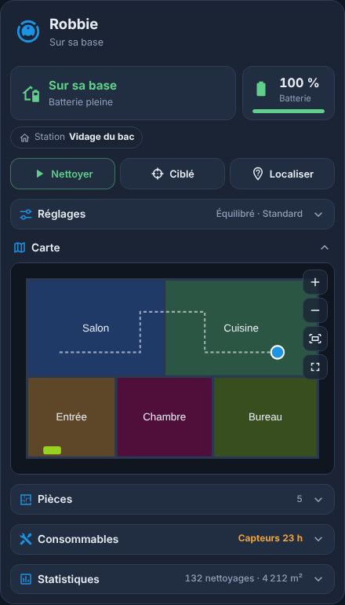
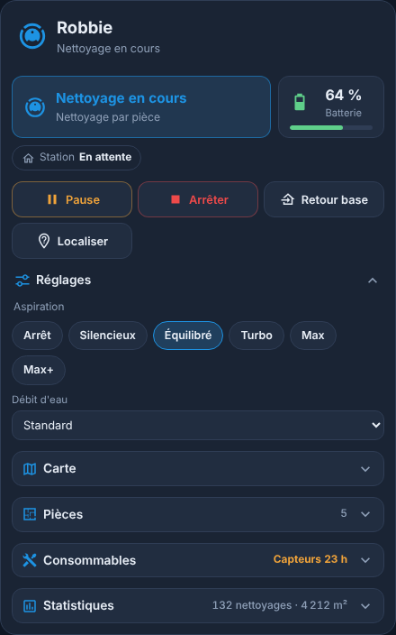
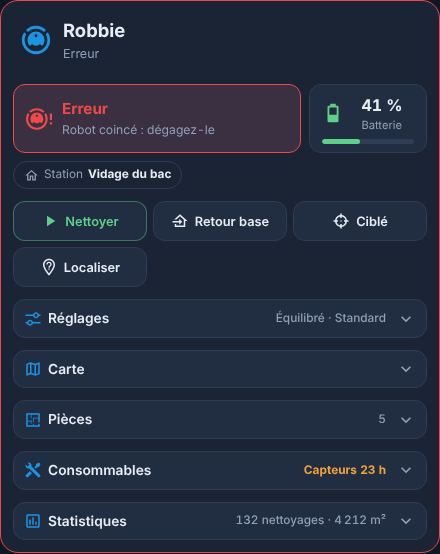
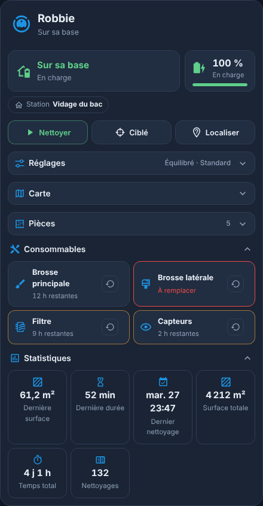
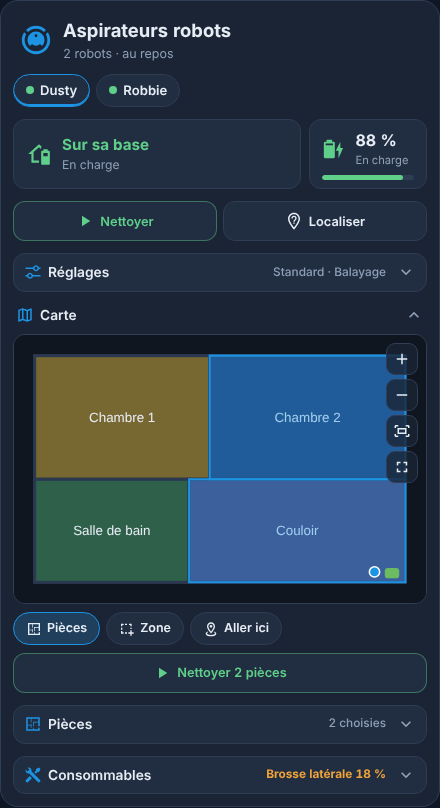
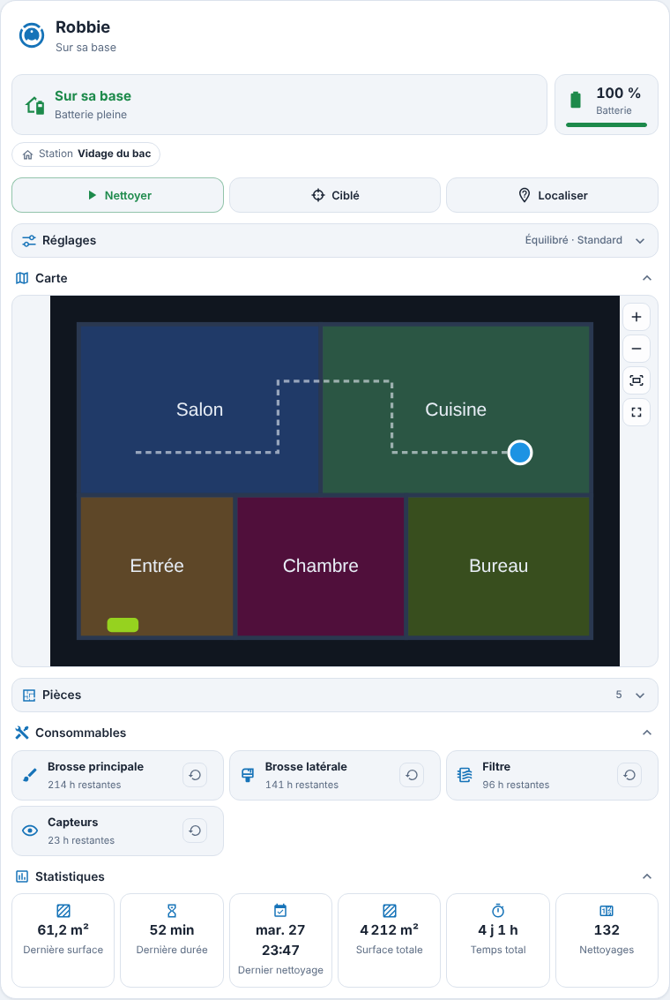

<p>
  ☕ <strong>Si cette carte vous est utile, vous pouvez soutenir le projet :</strong>
</p>

<div style="white-space: nowrap; line-height: 0;">
  <a
    href="https://www.buymeacoffee.com/Marlboro62"
    target="_blank"
    rel="noopener noreferrer"
    style="display: inline-block; text-decoration: none; vertical-align: middle;"
  ></a>&nbsp;&nbsp;<a
    href="https://ko-fi.com/M4M2QL45X"
    target="_blank"
    rel="noopener noreferrer"
    style="display: inline-block; text-decoration: none; vertical-align: middle;"
  ></a>
</div>

# Cartes Électroménager

Cartes Lovelace pour suivre l'électroménager connecté dans Home Assistant. Elles ont le style des cartes MyElectricalData new ([Carte Enedis Linky New](https://github.com/Marlboro62/content-card-linky-new)) et des [Cartes Serveur HA](https://github.com/Marlboro62/serveur-ha-card) : thème bleu nuit, version claire, ou thème Home Assistant.

| Type | Carte |
| --- | --- |
| `custom:electromenager-robot-card` | **Aspirateur robot** : état, batterie, commandes, puissance d'aspiration, carte du logement, nettoyage par pièce, consommables et statistiques |

**Aucune dépendance** : pas de button-card ni de card-mod. Les robots sont **détectés automatiquement**, un par onglet, et chaque élément sans capteur est simplement masqué.

| Sur sa base | Nettoyage en cours | Coincé |
| --- | --- | --- |
|  |  |  |

| Consommables usés | Carte interactive (pièces, zone) | Clair, sur PC |
| --- | --- | --- |
|  |  |  |

*Aperçus réalisés avec la démo et des valeurs fictives (robots, pièces et carte du logement inventés).*

**[▶ Essayer la démo en ligne](https://marlboro62.github.io/electromenager/docs/demo.html)** : robot sur sa base, en nettoyage, coincé ou avec des consommables usés, un ou deux robots, en sombre ou clair, sur téléphone ou PC.

## Installation

### Avec HACS (recommandé)

1. Dans HACS, menu **⋮** → **Dépôts personnalisés**.
2. Ajoutez `https://github.com/Marlboro62/electromenager` avec le type **Tableau de bord** (Dashboard).
3. Cherchez **Cartes Électroménager**, installez, puis rechargez la page (Ctrl+F5).

### Manuellement

1. Téléchargez [`electromenager-cards.js`](https://raw.githubusercontent.com/Marlboro62/electromenager/main/electromenager-cards.js) (clic droit → Enregistrer sous) et copiez-le dans `/config/www/`.
2. **Paramètres → Tableaux de bord → ⋮ → Ressources → Ajouter une ressource** : URL `/local/electromenager-cards.js`, type **Module JavaScript**.
3. Rechargez la page (Ctrl+F5).

## Carte Aspirateur robot — `custom:electromenager-robot-card`

```yaml
type: custom:electromenager-robot-card
```

La carte a un **éditeur visuel**. Sans réglage, elle affiche tous les aspirateurs (entités `vacuum`), avec les entités de leur appareil.

### Ce qu'elle affiche

- **Onglets** : un robot par onglet, avec un point de couleur. Sans onglet retenu, la carte ouvre le robot en train de nettoyer ou en erreur.
- **État** : sur sa base, nettoyage en cours, retour à la base, en pause, à l'arrêt, erreur ou hors ligne, avec le message du robot en français (en charge, batterie pleine, vidage du bac, lavage des serpillières, nettoyage par pièce…) ou l'erreur (robot coincé…). La carte prend une bordure rouge en cas d'erreur.
- **Batterie** : niveau, en charge ou non, orange sous 30 % et rouge sous 15 %. **Station** : état de la base quand l'intégration le donne.
- **Commandes** selon l'état : Nettoyer ou Reprendre, Pause, Arrêter, Retour base, nettoyage ciblé et Localiser (si le robot les propose).
- **Puissance d'aspiration** : les niveaux du robot, traduits (Silencieux, Équilibré, Turbo, Max…). **Réglages** de l'appareil (débit d'eau, mode de lavage…) en listes déroulantes.
- **Carte du logement interactive** : l'image de la carte fournie par l'intégration (entité `image` ou `camera`), rafraîchie pendant le nettoyage, avec zoom (molette, pincement, boutons +/−), déplacement et plein écran. Quand l'intégration donne la calibration de la carte (Dreame, Xiaomi, Map Extractor…) :
  - **Pièces** : touchez une pièce sur la carte pour la choisir (elle se colore), puis « Nettoyer N pièces » ;
  - **Zone** : tracez un rectangle, puis « Nettoyer la zone » ;
  - **Aller ici** : touchez un point, le robot s'y rend ;
  - position du robot sur la carte.
- **Nettoyage par pièce** : choisissez les pièces, puis « Nettoyer N pièces ».
- **Consommables** : brosse principale, brosse latérale, filtre, capteurs, serpillière, sac… en % ou en heures restantes, orange puis rouge quand ils s'usent. Bouton de **remise à zéro** après remplacement, confirmé en deux clics.
- **Statistiques** : dernière surface et durée, surface et temps total, nombre de nettoyages, dernier nettoyage.
- **Sections repliables**, pour garder une carte compacte : Réglages, Carte, Pièces, Consommables et Statistiques se déplient d'un clic, et affichent un résumé une fois repliées (puissance d'aspiration, nombre de pièces choisies, consommable le plus usé, nombre de nettoyages). Chaque navigateur garde votre choix ; au départ, seule la carte est dépliée (option `expanded`).

Un clic sur un élément ouvre la fiche de l'entité dans Home Assistant.

### Intégrations

La carte fonctionne avec toutes les intégrations d'aspirateur : elle lit l'entité `vacuum` et les capteurs de son appareil d'après leur nom (en français comme en anglais).

| Intégration | Pièces | État |
| --- | --- | --- |
| **Roborock** (intégrée à Home Assistant) | lues automatiquement (service `roborock.get_maps`) ; carte sans calibration : zoom seulement | prévue, non testée |
| **Dreame Vacuum** (HACS) | lues automatiquement (attribut `rooms`), carte interactive | testée (affichage) ; carte interactive à confirmer |
| **Xiaomi Miio** | à indiquer avec `rooms` | prévue, non testée |
| **Ecovacs** | à indiquer avec `rooms` | prévue, non testée |
| Autres (iRobot, Valetudo…) | à indiquer avec `rooms` et `service` | commandes et capteurs |

Si votre robot n'est pas bien reconnu, ouvrez une [issue](https://github.com/Marlboro62/electromenager/issues) avec la liste des entités de son appareil.

### Pièces

Quand l'intégration ne donne pas la liste des pièces, indiquez-les avec leur numéro de segment (visible dans l'application du robot ou les attributs de l'entité) :

```yaml
type: custom:electromenager-robot-card
rooms:
  - id: 16
    name: Salon
    icon: mdi:sofa
  - id: 17
    name: Cuisine
    icon: mdi:silverware-fork-knife
```

La carte appelle le service de l'intégration : `vacuum.send_command` avec `app_segment_clean` (Roborock), `dreame_vacuum.vacuum_clean_segment`, `xiaomi_miio.vacuum_clean_segment`, ou `spot_area` (Ecovacs). Pour une autre intégration, donnez le service à appeler par pièce :

```yaml
rooms:
  - name: Salon
    service: script.aspirer_salon
```

### Options

| Option | Rôle | Par défaut |
| --- | --- | --- |
| `title` | Titre de la carte | nom du robot, ou « Aspirateurs robots » |
| `icon`, `icon_color` | Icône et couleur de l'icône | `mdi:robot-vacuum`, bleu |
| `robots` | Robots affichés, dans cet ordre : entités `vacuum`, ou `{ entity, name, map, rooms }` | tous |
| `rooms` | Pièces (voir plus haut), pour tous les robots ou par robot dans `robots` | lues sur l'intégration |
| `expanded` | Sections dépliées au départ : `settings`, `map`, `rooms`, `consumables`, `stats` | `[map]` |
| `show_controls`, `show_map`, `show_rooms`, `show_consumables`, `show_stats` | Afficher chaque partie | `true` |
| `theme` | `v2` (bleu nuit MyElectricalData), `auto` (clair ou sombre selon Home Assistant) ou `ha` (thème Home Assistant) | `v2` |

## Support

Questions et problèmes : uniquement via les [issues GitHub](https://github.com/Marlboro62/electromenager/issues).

## Voir aussi

[Cartes Imprimantes 3D et bureau](https://github.com/Marlboro62/printers) · [Cartes Serveur HA](https://github.com/Marlboro62/serveur-ha-card) · [Carte OPNsense](https://github.com/Marlboro62/opnsense-card) · [Carte Enedis Linky New](https://github.com/Marlboro62/content-card-linky-new)

## Licence

MIT
