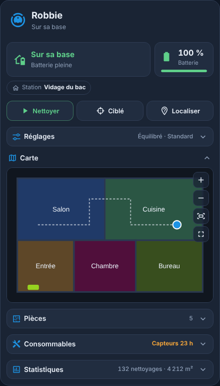
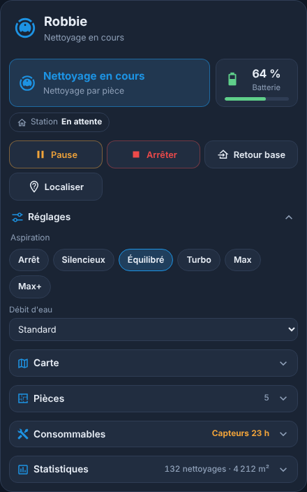
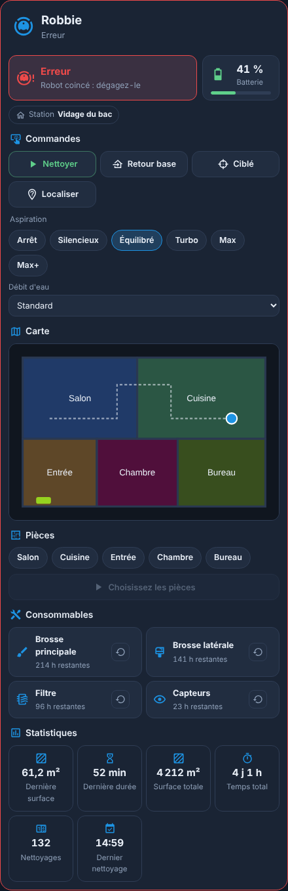
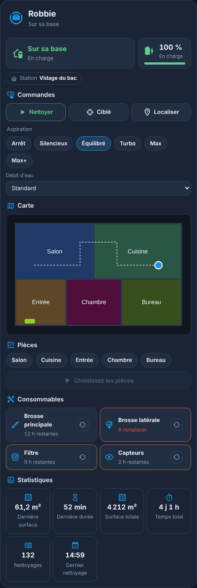
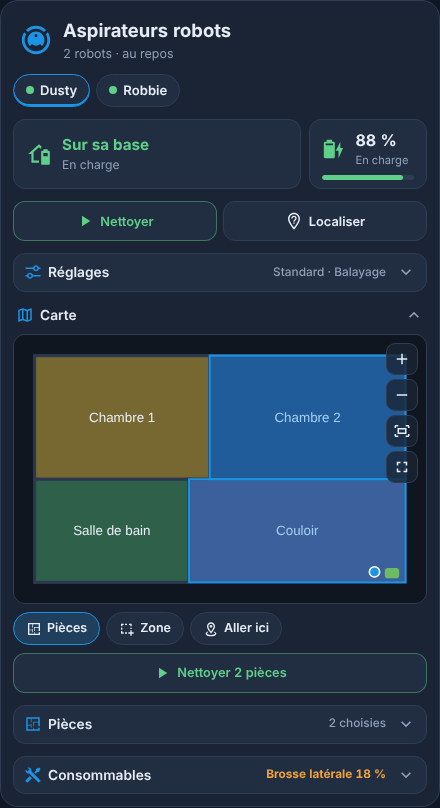
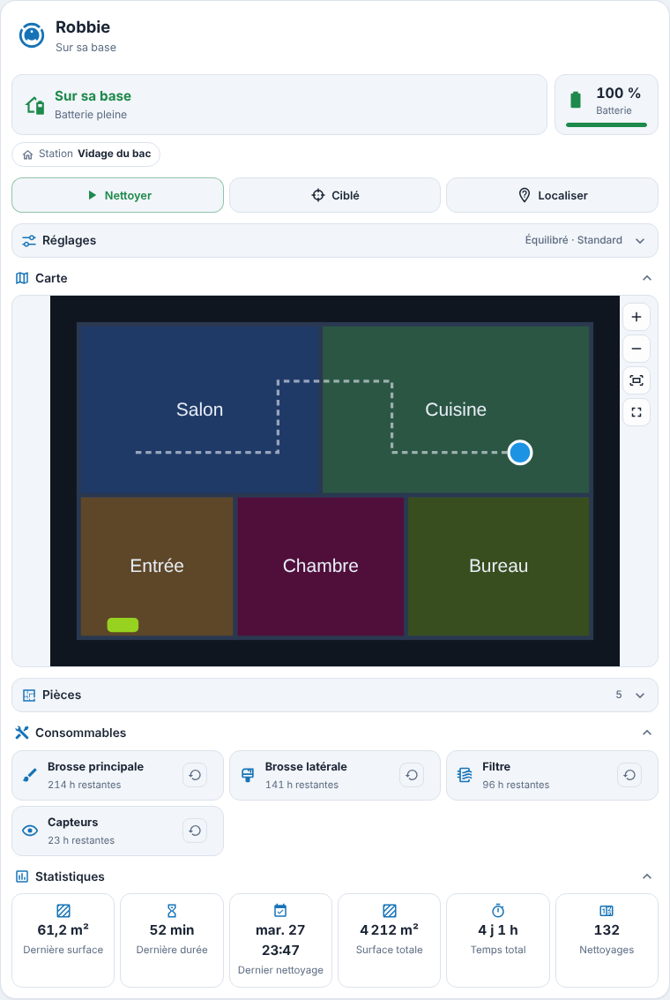
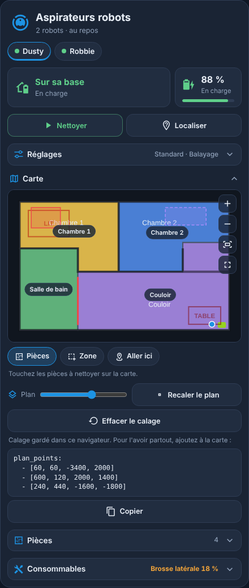
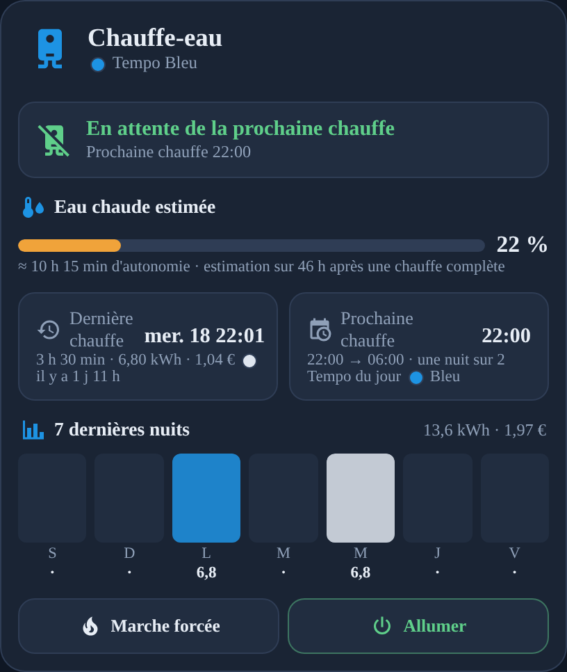
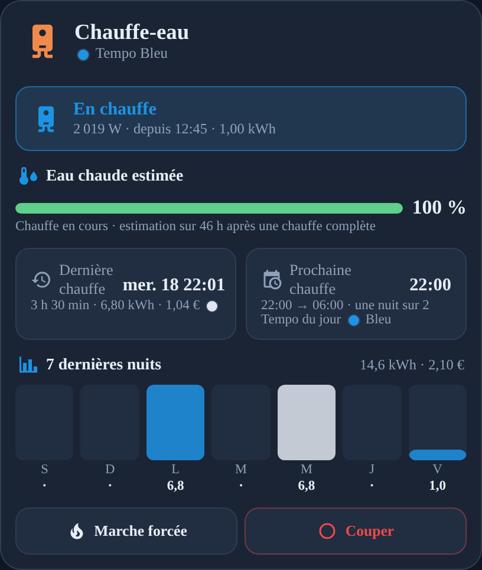

<p>
  ☕ <strong>Si cette carte vous est utile, vous pouvez soutenir le projet :</strong>
</p>

<div style="white-space: nowrap; line-height: 0;">
  <a
    href="https://www.buymeacoffee.com/Marlboro62"
    target="_blank"
    rel="noopener noreferrer"
    style="display: inline-block; text-decoration: none; vertical-align: middle;"
  ></a>&nbsp;&nbsp;<a
    href="https://ko-fi.com/M4M2QL45X"
    target="_blank"
    rel="noopener noreferrer"
    style="display: inline-block; text-decoration: none; vertical-align: middle;"
  ></a>
</div>

# Cartes Électroménager

[](https://hacs.xyz/)
[](https://github.com/Marlboro62/electromenager/releases)

Cartes Lovelace pour suivre l'électroménager connecté dans Home Assistant. Elles ont le style des cartes MyElectricalData new ([Carte Enedis Linky New](https://github.com/Marlboro62/content-card-linky-new)) et des [Cartes Serveur HA](https://github.com/Marlboro62/serveur-ha-card) : thème bleu nuit, version claire, ou thème Home Assistant.

| Type | Carte |
| --- | --- |
| `custom:electromenager-robot-card` | **Aspirateur robot** : état, batterie, commandes, puissance d'aspiration, carte du logement, nettoyage par pièce, consommables et statistiques |
| `custom:electromenager-chauffe-eau-card` | **Chauffe-eau** (cumulus sur relais) : état, eau chaude estimée, dernière et prochaine chauffe, nuits de chauffe, coût au prix Tempo, marche forcée |

**Aucune dépendance** : pas de button-card ni de card-mod. Les robots sont **détectés automatiquement**, un par onglet, et chaque élément sans capteur est simplement masqué.

| Sur sa base | Nettoyage en cours | Coincé |
| --- | --- | --- |
|  |  |  |

| Consommables usés | Carte interactive (pièces, zone) | Clair, sur PC |
| --- | --- | --- |
|  |  |  |

| Plan du logement superposé (fictif) |
| --- |
|  |

*Aperçus réalisés avec la démo et des valeurs fictives (robots, pièces et carte du logement inventés).*

**[▶ Essayer la démo en ligne](https://marlboro62.github.io/electromenager/docs/demo.html)** : robot sur sa base, en nettoyage, coincé ou avec des consommables usés, un ou deux robots, en sombre ou clair, sur téléphone ou PC.

## Installation

### Avec HACS (recommandé)

1. Dans HACS, cherchez **Cartes Électroménager** et installez-les.
2. Rechargez la page (Ctrl+F5).

Si la carte n'apparaît pas encore dans la recherche de HACS, ajoutez le dépôt à la main : menu **⋮** → **Dépôts personnalisés**, adresse `https://github.com/Marlboro62/electromenager`, type **Tableau de bord** (Dashboard), puis cherchez **Cartes Électroménager**.

### Manuellement

1. Téléchargez [`electromenager-cards.js`](https://raw.githubusercontent.com/Marlboro62/electromenager/main/electromenager-cards.js) (clic droit → Enregistrer sous) et copiez-le dans `/config/www/`.
2. **Paramètres → Tableaux de bord → ⋮ → Ressources → Ajouter une ressource** : URL `/local/electromenager-cards.js`, type **Module JavaScript**.
3. Rechargez la page (Ctrl+F5).

## Carte Aspirateur robot — `custom:electromenager-robot-card`

```yaml
type: custom:electromenager-robot-card
```

La carte a un **éditeur visuel**. Sans réglage, elle affiche tous les aspirateurs (entités `vacuum`), avec les entités de leur appareil.

### Ce qu'elle affiche

- **Onglets** : un robot par onglet, avec un point de couleur. Sans onglet retenu, la carte ouvre le robot en train de nettoyer ou en erreur.
- **État** : sur sa base, nettoyage en cours, retour à la base, en pause, à l'arrêt, erreur ou hors ligne, avec le message du robot en français (en charge, batterie pleine, vidage du bac, lavage des serpillières, nettoyage par pièce…) ou l'erreur (robot coincé…). La carte prend une bordure rouge en cas d'erreur.
- **Batterie** : niveau, en charge ou non, orange sous 30 % et rouge sous 15 %. **Station** : état de la base quand l'intégration le donne.
- **Commandes** selon l'état : Nettoyer ou Reprendre, Pause, Arrêter, Retour base, nettoyage ciblé et Localiser (si le robot les propose).
- **Puissance d'aspiration** : les niveaux du robot, traduits (Silencieux, Équilibré, Turbo, Max…). **Réglages** de l'appareil (débit d'eau, mode de lavage…) en listes déroulantes.
- **Carte du logement interactive** : l'image de la carte fournie par l'intégration (entité `image` ou `camera`), rafraîchie pendant le nettoyage, avec zoom (molette, pincement, boutons +/−), déplacement et plein écran. Quand l'intégration donne la calibration de la carte (Dreame, Xiaomi, Map Extractor…) :
  - **Pièces** : touchez une pièce sur la carte pour la choisir : sa vraie forme s'éclaire et les autres pièces s'assombrissent, puis « Nettoyer N pièces » ;
  - **Zone** : tracez un rectangle, puis « Nettoyer la zone » ;
  - **Aller ici** : touchez un point, le robot s'y rend ;
  - position du robot sur la carte ;
  - **noms des pièces** en étiquettes lisibles, la pièce choisie en bleu ;
  - **zones interdites** (rouge), **zones sans serpillière** (violet, pointillés) et **murs virtuels** définis dans l'application du robot.

  **Plan de votre logement superposé** (option `plan`) : votre propre plan (murs, portes, meubles…) se cale sur la carte du robot et s'y fond, avec une transparence réglable.
  1. Enregistrez votre plan (PNG ou JPG, fond blanc) dans le dossier **`/media`** de Home Assistant, par exemple `/media/plan.png`, puis indiquez `plan: media-source://media_source/local/plan.png`. Évitez `/config/www` (`/local/…`) : ces fichiers sont accessibles **sans connexion** à quiconque connaît l'adresse.
  2. Sous la carte, **« Caler mon plan »** : touchez un repère net sur la carte du robot (coin de mur, porte), puis le même repère sur votre plan, trois fois.
  3. Le calage est gardé dans le navigateur ; la carte affiche le YAML `plan_points` à copier dans sa configuration pour l'avoir sur tous vos appareils.

  Option `rotate` (0, 90, 180 ou 270) : tourne la carte pour l'afficher dans le sens de votre logement ; les noms des pièces restent droits.
- **Nettoyage par pièce** : choisissez les pièces, puis « Nettoyer N pièces ».
- **Consommables** : brosse principale, brosse latérale, filtre, capteurs, serpillière, sac… en % ou en heures restantes, orange puis rouge quand ils s'usent. Bouton de **remise à zéro** après remplacement, confirmé en deux clics.
- **Statistiques** : dernière surface et durée, surface et temps total, nombre de nettoyages, dernier nettoyage.
- **Sections repliables**, pour garder une carte compacte : Réglages, Carte, Pièces, Consommables et Statistiques se déplient d'un clic, et affichent un résumé une fois repliées (puissance d'aspiration, nombre de pièces choisies, consommable le plus usé, nombre de nettoyages). Chaque navigateur garde votre choix ; au départ, seule la carte est dépliée (option `expanded`).

Un clic sur un élément ouvre la fiche de l'entité dans Home Assistant.

### Intégrations

La carte fonctionne avec toutes les intégrations d'aspirateur : elle lit l'entité `vacuum` et les capteurs de son appareil d'après leur nom (en français comme en anglais).

| Intégration | Pièces | État |
| --- | --- | --- |
| **Roborock** (intégrée à Home Assistant) | lues automatiquement (service `roborock.get_maps`) ; carte sans calibration : zoom seulement | prévue, non testée |
| **Dreame Vacuum** (HACS) | lues automatiquement (attribut `rooms`), carte interactive | testée (affichage) ; carte interactive à confirmer |
| **Xiaomi Miio** | à indiquer avec `rooms` | prévue, non testée |
| **Ecovacs** | à indiquer avec `rooms` | prévue, non testée |
| Autres (iRobot, Valetudo…) | à indiquer avec `rooms` et `service` | commandes et capteurs |

Si votre robot n'est pas bien reconnu, ouvrez une [issue](https://github.com/Marlboro62/electromenager/issues) avec la liste des entités de son appareil.

### Pièces

Quand l'intégration ne donne pas la liste des pièces, indiquez-les avec leur numéro de segment (visible dans l'application du robot ou les attributs de l'entité) :

```yaml
type: custom:electromenager-robot-card
rooms:
  - id: 16
    name: Salon
    icon: mdi:sofa
  - id: 17
    name: Cuisine
    icon: mdi:silverware-fork-knife
```

La carte appelle le service de l'intégration : `vacuum.send_command` avec `app_segment_clean` (Roborock), `dreame_vacuum.vacuum_clean_segment`, `xiaomi_miio.vacuum_clean_segment`, ou `spot_area` (Ecovacs). Pour une autre intégration, donnez le service à appeler par pièce :

```yaml
rooms:
  - name: Salon
    service: script.aspirer_salon
```

### Options

| Option | Rôle | Par défaut |
| --- | --- | --- |
| `title` | Titre de la carte | nom du robot, ou « Aspirateurs robots » |
| `icon`, `icon_color` | Icône et couleur de l'icône | `mdi:robot-vacuum`, bleu |
| `robots` | Robots affichés, dans cet ordre : entités `vacuum`, ou `{ entity, name, map, rooms }` | tous |
| `rooms` | Pièces (voir plus haut), pour tous les robots ou par robot dans `robots` | lues sur l'intégration |
| `plan`, `plan_opacity` | Plan du logement superposé (voir plus haut) et son opacité au départ | aucun, `0.6` |
| `plan_points` | Calage du plan : 3 points `[x_plan, y_plan, x_robot, y_robot]`, donnés par la carte après « Caler mon plan » | aucun |
| `rotate` | Rotation de la carte du logement : `0`, `90`, `180`, `270` | `0` |
| `room_labels`, `show_zones` | Noms des pièces, zones interdites et murs virtuels sur la carte | `true` |
| `expanded` | Sections dépliées au départ : `settings`, `map`, `rooms`, `consumables`, `stats` | `[map]` |
| `show_controls`, `show_map`, `show_rooms`, `show_consumables`, `show_stats` | Afficher chaque partie | `true` |
| `theme` | `v2` (bleu nuit MyElectricalData), `auto` (clair ou sombre selon Home Assistant) ou `ha` (thème Home Assistant : fond, textes, bordures, et icônes et sélections à la `primary-color` du thème) | `v2` |

## Carte Chauffe-eau — `custom:electromenager-chauffe-eau-card`

Pour un chauffe-eau (cumulus) piloté par un relais ou une prise connectée qui mesure la puissance.

```yaml
type: custom:electromenager-chauffe-eau-card
switch: switch.cumulus
forced: input_boolean.marche_forcee_cumulus   # facultatif : bouton Marche forcée
cycle: 2                                       # chauffe une nuit sur 2
```

| En attente | En chauffe |
| --- | --- |
|  |  |

*Aperçus réalisés avec des valeurs fictives.*

### Ce qu'elle affiche

- **État** : en chauffe (puissance, heure de début, énergie), allumé et eau chaude atteinte, en attente, relais indisponible, ou **alerte** quand il n'a pas chauffé depuis plus de 48 h (carte bordée de rouge).
- **Eau chaude estimée** : 100 % à la fin d'une chauffe, puis baisse sur l'autonomie indiquée (46 h par défaut).
- **Dernière chauffe** : date, durée, énergie et coût, avec la couleur Tempo de la nuit.
- **Prochaine chauffe** d'après le rythme (chaque nuit, une nuit sur 2, sur 3…) et la plage horaire.
- **Nuits de chauffe** : énergie par nuit sur 7 jours, barres à la couleur Tempo, total en kWh et en euros.
- **Boutons** : marche forcée (`input_boolean`), allumer ou couper le relais.

Les chauffes sont lues dans l'**historique de la puissance** : au-dessus du seuil (500 W), le chauffe-eau chauffe vraiment. Une coupure de moins de 30 minutes (redémarrage de Home Assistant, MQTT, Zigbee) ne coupe pas une chauffe en deux, et un relais allumé dont le thermostat est satisfait ne compte pas comme une chauffe.

Le **coût** compte chaque kWh au prix **HC ou HP** de son heure et de la couleur Tempo du jour (capteurs `sensor.myelectricaldata_tempo_price_<couleur>_hc` / `_hp` ou `sensor.edf_tempo_price_<couleur>_hc` / `_hp`) : une marche forcée en journée apparaît « dont … kWh en heures pleines ». Avec l'option `price`, un prix fixe sert à toute heure.

La puissance et l'énergie sont trouvées sur le même appareil que le relais. La couleur Tempo du jour vient de MyElectricalData ou de RTE Tempo si l'intégration est installée.

### Options

| Option | Rôle | Par défaut |
| --- | --- | --- |
| `switch` | Relais du chauffe-eau (`switch` ou `input_boolean`) | trouvé par son nom (cumulus, chauffe-eau, ballon, ECS) |
| `power`, `energy` | Capteurs de puissance (W) et d'énergie (kWh) | trouvés sur le relais |
| `forced` | Interrupteur de marche forcée (`input_boolean`) | trouvé par son nom |
| `tempo` | Couleur Tempo du jour | MyElectricalData ou RTE |
| `price` | Prix du kWh fixe (`0.1952`) ou capteur de prix | prix Tempo HC ou HP de la couleur, selon l'heure |
| `cycle`, `cycle_offset` | Une nuit sur N ; nuit de chauffe quand le nombre de jours depuis l'an 1 du jour (moins 6 h) modulo N vaut `cycle_offset` (`date.toordinal()` de Python) | `2`, `0` |
| `start`, `end` | Plage de chauffe | `22:00`, `06:00` |
| `hc_start`, `hc_end` | Heures creuses, pour le prix HC ou HP de chaque kWh | `22:00`, `06:00` |
| `autonomy` | Heures d'eau chaude après une chauffe complète | `46` |
| `alert_after` | Heures sans chauffe avant l'alerte | `48` |
| `threshold` | Puissance au-dessus de laquelle il chauffe (W) | `500` |
| `days` | Nuits dans le graphique (3 à 14) | `7` |
| `show_controls` | Boutons | `true` |
| `theme` | `v2`, `auto` ou `ha` | `v2` |

La carte n'allume ni ne coupe rien d'elle-même : la programmation reste dans votre automatisation. `cycle` et `cycle_offset` servent seulement à afficher la prochaine chauffe ; réglez-les comme elle.

## Support

Questions et problèmes : uniquement via les [issues GitHub](https://github.com/Marlboro62/electromenager/issues).

## Voir aussi

[Cartes Imprimantes 3D et bureau](https://github.com/Marlboro62/printers) · [Cartes Serveur HA](https://github.com/Marlboro62/serveur-ha-card) · [Carte OPNsense](https://github.com/Marlboro62/opnsense-card) · [Carte Enedis Linky New](https://github.com/Marlboro62/content-card-linky-new)

## Licence

MIT

## Nom du projet et forks

Ce dépôt est la seule source officielle de **Cartes Électroménager** (releases, HACS, support),
maintenu par [Marlboro62](https://github.com/Marlboro62).

La licence MIT autorise à copier, modifier et redistribuer le code. Si vous publiez une version modifiée :

- gardez les mentions de copyright du fichier [`LICENSE`](https://github.com/Marlboro62/electromenager/blob/main/LICENSE) (© Marlboro62) ;
- **donnez-lui un autre nom** et d'autres types de carte (`custom:electromenager-…-card` sont ceux de ce dépôt) :
  Home Assistant ne peut pas charger deux cartes du même type, et personne ne doit confondre les deux versions dans HACS ;
- ne la présentez pas comme la version officielle et n'orientez pas vers ce dépôt les demandes
  de support qui concernent votre version.

Une correction ou une idée ? Les **pull requests** et les **issues** sont les bienvenues ici :
elles profitent à tous les utilisateurs.
